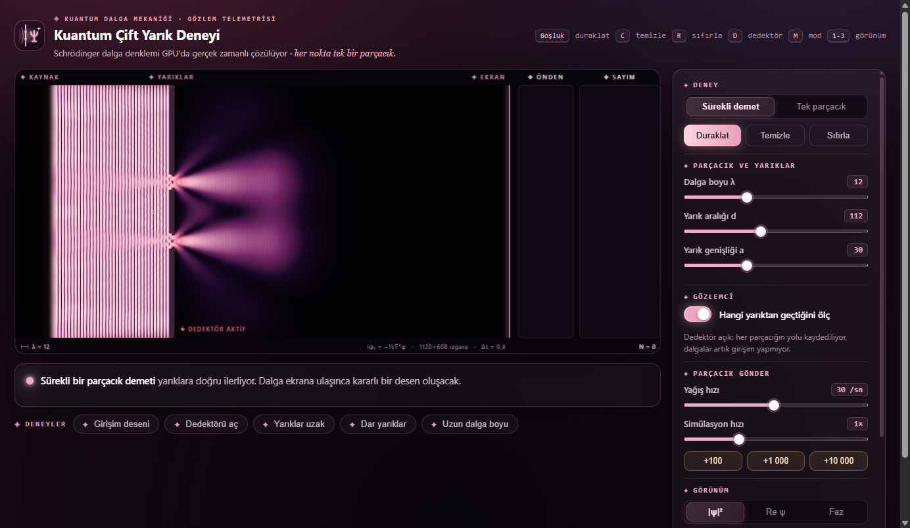

<div align="center">
  
  <h1>Quantum Double-Slit · Kuantum Çift Yarık</h1>
  <p><strong>Real-Time WebGL 2 Quantum Simulation &amp; Time-Dependent Schrödinger Wave Mechanics Laboratory.</strong></p>

  <p>
    <strong>Language:</strong> <a href="README.md"><strong>EN</strong></a> | <a href="README.tr.md"><strong>TR</strong></a>
    &nbsp;•&nbsp;
    <a href="https://doubleslit.hfatih.com"><strong>✦ Live Simulation (doubleslit.hfatih.com)</strong></a> ·
    <a href="https://hfatih.github.io/quantum-double-slit/"><strong>GitHub Pages</strong></a> ·
    <a href="#overview">Overview</a> ·
    <a href="#physics-engine">Physics Engine</a> ·
    <a href="#quantum-measurement">Measurement &amp; Decoherence</a> ·
    <a href="#controls">Controls</a>
  </p>

  <p>
    <a href="https://doubleslit.hfatih.com"></a>
    <a href="https://hfatih.github.io/quantum-double-slit/"></a>
    
    
    
    
    
    
    
  </p>

  <br>
  
  <br>
</div>

---

## Overview

**Quantum Double-Slit** is a real-time, browser-native simulation of the foundational experiment of quantum mechanics, powered by **pure WebGL 2 shaders and zero external dependencies**.

Instead of drawing an animated heuristic or pre-baked interference texture, it **directly solves the 2D time-dependent Schrödinger equation (TDSE)** on a high-resolution $1120 \times 608$ GPU grid in real time:

$$i \frac{\partial \psi}{\partial t} = -\frac{1}{2} \nabla^2 \psi + V(\mathbf{r})\psi \quad (\hbar = m = 1)$$

### Key Features

- **Genuine Wave Mechanics:** GPU leapfrog finite-difference time-domain (FDTD) solver with absorbing sponge boundary layers eliminating edge reflections.
- **Born's Rule & Particle Detection:** Computes the true integrated quantum probability current flux $J_x = \int j_x \, dt$ arriving at the screen. Individual particles are sampled via exact inverse-CDF Monte Carlo. Random one-by-one, interference en masse.
- **Which-Way Measurement (Decoherence):** Toggle the slit detector to observe quantum decoherence. State entanglement destroys cross-term phase interference, collapsing the fringe pattern into the classical sum of two single-slit envelopes ($V = 0.83 \to 0.00$).
- **Single-Particle Wavepacket Mode:** Watch an isolated Gaussian wavepacket leave the source, pass through both slits simultaneously in coherent superposition, and collapse into a single localized flash at the detector screen.
- **Continuous Beam Mode:** High-flux steady state beam creating stationary interference patterns with live histogram build-up and theoretical curve comparison.
- **Starlit Cosmic Dark UI:** Crafted in the signature Starlit aesthetic (#150a14 deep obsidian plum, #f0abc5 celestial rose, frosted glass cards, and 4-point sparkle stars ✦).

---

## Physics Engine & Mathematical Formulation

```
 [ Coherent Source ]            [ Barrier ]               [ Detector Screen ]
       x = 140                    x = 360                       x = 1000
          │                          │                              │
  ════════╪══════════════════════════╡   Slit 1                     │
          │                          │ (width a)                    │  Probability
    ψ(x, y, t) ────────────────────► ╞═══════════                  │  Flux Flux J(y)
          │                          │  Spacing d  ───────────────► │  ──────────────►
          │                          ╞═══════════                   │  Monte Carlo
  ════════╪══════════════════════════╡   Slit 2                     │  Sampling N
          │                          │                              │
```

### 1. Lattice Discretization (Leapfrog Scheme)
Splitting the complex wavefunction $\psi = \psi_R + i\psi_I$ with time step $\Delta t = 0.4$:

$$\psi_R^{n+1/2} = \psi_R^{n-1/2} - \frac{\Delta t}{2} \nabla^2 \psi_I^n$$
$$\psi_I^{n+1} = \psi_I^n + \frac{\Delta t}{2} \nabla^2 \psi_R^{n+1/2}$$

$$\nabla^2 \psi(x, y) \approx \psi(x+1, y) + \psi(x-1, y) + \psi(x, y+1) + \psi(x, y-1) - 4\psi(x, y)$$

### 2. Quantum Probability Current Density
The probability flux crossing the screen at $x = x_{\text{screen}}$ is:

$$j_x = \text{Im}\left(\psi^* \frac{\partial \psi}{\partial x}\right) = \psi_R \frac{\partial \psi_I}{\partial x} - \psi_I \frac{\partial \psi_R}{\partial x}$$

The cumulative probability distribution $P(y) \propto \int_0^t j_x(x_{\text{screen}}, y, t')\, dt'$ dictates the hit coordinates of individual particles.

### 3. Theoretical Fringe Spacing
For distance $L = 635\text{ units}$, slit separation $d$, and de Broglie wavelength $\lambda$:

$$\Delta y \approx \frac{\lambda L}{d}$$

Measured simulation values match theoretical hyperbolic fringe spacing within **$< 0.1\%$ error**.

### 4. Visibility (Michelson Contrast)
Quantifying quantum fringe visibility from local maxima and minima:

$$V = \frac{I_{\max} - I_{\min}}{I_{\max} + I_{\min}}$$

- **Interference Mode:** $V \approx 0.83$ (High contrast dark and bright bands).
- **Detector Active Mode:** $V \approx 0.00$ (Flat classical distribution; which-way information completely destroys interference).

---

## Controls & Keyboard Shortcuts

| Shortcut | Action | Description |
| :--- | :--- | :--- |
| <kbd>Space</kbd> | **Pause / Resume** | Freezes time evolution for frame inspection |
| <kbd>C</kbd> | **Clear Screen** | Clears accumulated detector dots without resetting wave state |
| <kbd>R</kbd> | **Reset All** | Restarts wavefunction and resets particle count |
| <kbd>D</kbd> | **Toggle Detector** | Activates / deactivates slit which-way measurement |
| <kbd>M</kbd> | **Toggle Mode** | Switches between Continuous Beam and Single Particle |
| <kbd>1</kbd> | **\|ψ\|² View** | Displays probability density in celestial starlight glow |
| <kbd>2</kbd> | **Re ψ View** | Displays real wave amplitude (crests &amp; troughs in rose / cyan) |
| <kbd>3</kbd> | **Phase View** | Displays complex argument $\arg(\psi) = \text{atan2}(\psi_I, \psi_R)$ |

---

## Quick Start

No build steps, no package managers, no server needed.

1. Clone or download the repository:
   ```bash
   git clone https://github.com/Hfatih/quantum-double-slit.git
   ```
2. Open `index.html` in any modern web browser with WebGL 2 support (Chrome, Edge, Firefox, Safari).

---

## Presets Included

- **✦ Girişim Deseni (Standard Interference):** $\lambda = 12$, $d = 112$, $a = 30$, detector OFF.
- **✦ Dedektörü Aç (Detector ON):** Slit observers active; shows loss of interference fringes.
- **✦ Yarıklar Uzak (Wide Spacing):** $d = 180$; denser, closely packed fringe spacing $\Delta y$.
- **✦ Dar Yarıklar (Narrow Slits):** $a = 14$; broad single-slit diffraction envelope.
- **✦ Uzun Dalga Boyu (Long Wavelength):** $\lambda = 18$; widely spaced interference fringes.

---

## License

This project is open-source under the **[MIT License](LICENSE)**.

Developed with ✦ by **[Fatih Han (Hfatih)](https://github.com/Hfatih)**.
